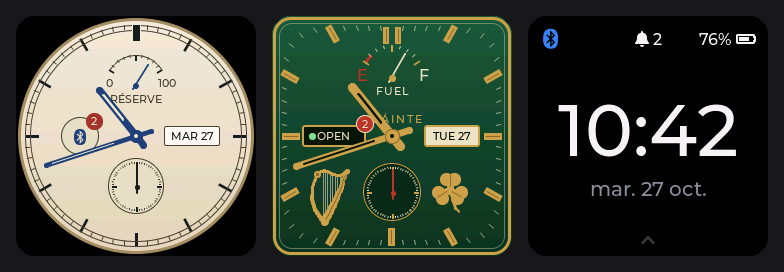
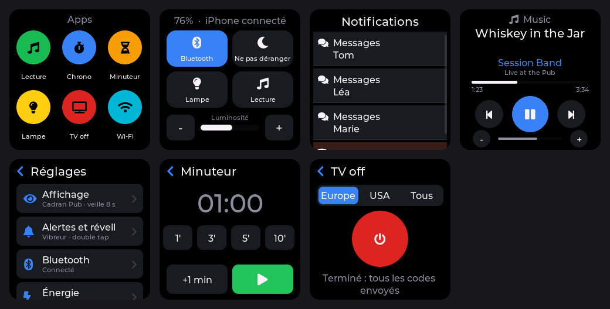
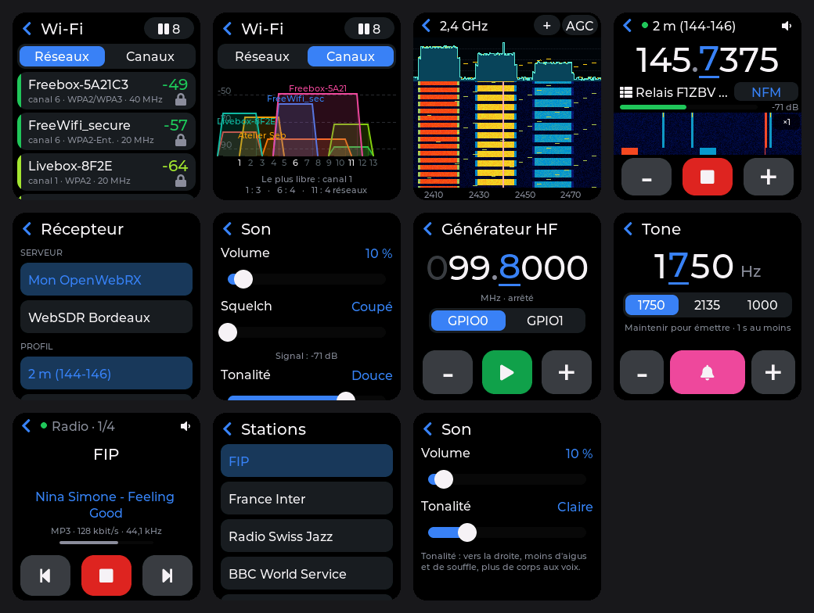

# twatch-idf — firmware compagnon iPhone pour la LilyGo T-Watch 2020 V1

Français · **[English](README.md)**

Firmware écrit de zéro pour la **LilyGo T-Watch 2020 V1**, en **ESP-IDF 5.5** pur (sans
Arduino), avec **LVGL 9** et **NimBLE**. La montre devient un compagnon d'iPhone discret et
endurant : notifications, appels, lecture en cours, heure synchronisée, et quelques apps
pratiques.

Priorités, dans l'ordre : **stabilité**, **autonomie**, **finition**.





*(rendus PC de l'interface réelle avec des données factices)*

> Projet indépendant, sans lien avec Apple Inc. ni LilyGo (Shenzhen Xinyuan Electronic
> Technology), qui ne l'approuvent ni ne le parrainent. Voir
> [Marques et avertissement](#marques-et-avertissement).

---

## Fonctionnalités

- **Notifications iPhone** (Apple Notification Center Service, aucune app à installer sur le
  téléphone) : liste triée, détail, actions iOS (*Effacer*, *Répondre*, *Accepter*/*Refuser*
  un appel), suppression synchronisée dans les deux sens, vibreur.
- Écran d'**appel entrant**.
- **Lecture en cours** (Apple Media Service) : titre, artiste, album, progression, volume,
  lecture/pause, précédent/suivant, volume, pour toute app audio iOS. (AMS ne transmet pas la
  pochette.)
- **Heure et fuseau** (heure d'été comprise) récupérés de l'iPhone (Current Time Service) ; la
  RTC PCF8563 garde l'heure UTC.
- **Trois cadrans** : *Rétro* (cadran ivoire, aiguilles bleuies, réserve de marche =
  batterie, guichet date, petite seconde), *Pub* (carré plein écran, vert bouteille et laiton,
  harpe, jauge FUEL, enseigne OPEN/CLOSED pour la liaison iPhone) et *Digital*.
- **Apps** : lanceur avec *Chrono* (tours), *Minuteur* (bipe et vibre même écran éteint, puis
  se rouvre), *Lampe* (blanc/rouge), **analyseur Wi-Fi** (réseaux avec RSSI, canal, sécurité ;
  occupation des canaux 2,4 GHz et canal le plus libre ; fiche détaillée de chaque point
  d'accès avec l'historique du signal), **SDR** (spectre et waterfall 2,4 GHz en direct à
  partir des échantillons I/Q bruts de la radio de l'ESP32 : bande entière ou un canal
  ±10 MHz, marqueur, maintien de crête), **WebRX** (écoute de tes récepteurs OpenWebRX /
  OpenWebRX+ par le Wi-Fi, `https` compris, sur le haut-parleur de la montre : jusqu'à 4
  serveurs, profils, signets, modes du serveur, squelch, tonalité en 5 paliers, S-mètre et
  mini-waterfall ; continue écran éteint — voir le [guide WebRX](docs/fr/webrx.md)), **Tone** (tonalité
  d'ouverture de relais sur le haut-parleur, 1750 Hz par défaut, réglable de 100 à 4000 Hz avec
  préréglages : maintenir pour émettre, 1 s au moins), **Radio** (webradios par le Wi-Fi sur le
  haut-parleur : MP3 et AAC/HE-AAC, `https`, listes .m3u/.pls, titres en cours, jusqu'à 12
  stations, volume et tonalité en 5 paliers ; continue écran éteint à 80 MHz et puissance Wi-Fi
  réduite — voir le [guide Radio](docs/fr/radio.md)),
  *Porteuse* (signal HF de test en carré, 5 à 125 MHz,
  issu de la PLL audio de l'ESP32) et *TV off* (éteint la plupart des téléviseurs par la LED
  infrarouge, codes Europe/USA). Une app ouverte garde la main : l'écran s'éteint dessus et
  le réveil y revient. Un petit cadre d'applications permet d'en ajouter en un seul fichier.
- **Les notifications ne font jamais quitter une app ou un menu** : elles glissent en
  bannière par-dessus (toucher pour lire, glisser vers le haut pour fermer) ; sur le cadran,
  elles s'ouvrent en plein écran comme avant.
- **Contrôles rapides** : Bluetooth, **Ne pas déranger**, lampe, lecture, luminosité.
- Interface **en français ou en anglais**, changement immédiat sans redémarrage.
- **Mise à jour sans fil** depuis l'iPhone en Wi-Fi (la montre devient point d'accès), avec
  retour automatique en cas de problème et **retour à la version précédente** depuis la
  montre.
- Appairage sécurisé (LE Secure Connections + code à 6 chiffres), reconnexion automatique.
- **Écran Énergie** : consommation moyenne mesurée par le compteur coulométrique de l'AXP202,
  décharge précédente, **jauge adaptative** qui apprend la capacité réelle d'une batterie
  usée.
- Mode avion (Bluetooth coupé → vrai light sleep automatique).
- Utilise la PSRAM de 8 Mo (4 Mo adressables) pour les grosses allocations.
- Démarrage quasi instantané, coredump en flash en cas de crash, journal BLE consultable sur
  la montre.

**Consommation mesurée :** environ **7,7 mA en veille** et 8 à 9 mA de moyenne en usage réel
(≈ 3 % du temps écran allumé, iPhone connecté), soit à peu près deux jours avec une batterie
de 380 mAh en bon état.

---

## Gestes

| Où | Geste / bouton | Effet |
|---|---|---|
| Cadran | glisser ↑ | Notifications (refermer : ↓ ou →) |
| Cadran | glisser ↓ | Contrôles rapides (refermer : ↑ ou →) |
| Cadran | glisser ← | Apps : Lecture, Chrono, Minuteur, Lampe, TV off, Wi-Fi, SDR, WebRX, Tone, Radio, Porteuse, Énergie, Réglages |
| Cadran | appui long | Choix du cadran |
| Partout ailleurs | glisser → ou « ‹ » | Retour à l'écran d'où l'on vient |
| Écran éteint | double tap | Réveil (sur la dernière notif non vue en mode discret) |
| Bouton, écran éteint | appui court | Réveil |
| Bouton, hors cadran | appui court | Retour au cadran (dans WebRX pendant l'écoute : écran éteint, l'écoute continue) |
| Bouton, sur le cadran | appui court | Éteint l'écran |
| Bouton | 4 s | Coupure matérielle (AXP202) |

**Ne pas déranger** : les notifications ne font ni vibrer ni allumer l'écran et attendent
dans la liste ; les appels sonnent toujours. Une lune le signale sur le cadran.

**Réglages** (← puis *Réglages*) : *Affichage* (cadran, luminosité, extinction, langue),
*Alertes et réveil* (vibreur, allumage sur notif ou mode discret, double tap, test du
haut-parleur), *Bluetooth* (mode avion, appairage, *Oublier les appareils* derrière une
confirmation), *Énergie*, *À propos*, *Mise à jour*.

---

## Démarrage

### 1. Flasher une fois par USB

Télécharger `twatch2020v1-full.bin` depuis la page [Releases](../../releases), puis :

```bash
esptool.py --chip esp32 -b 921600 write_flash 0x0 twatch2020v1-full.bin
```

Cela efface tout (appairages compris). Les mises à jour suivantes se font en Wi-Fi.

### 2. Appairer l'iPhone

1. Montre : glisser ← → *Réglages* → *Bluetooth* → **Appairer un iPhone**.
2. iPhone : *Réglages › Bluetooth* → **T-Watch**.
3. Saisir sur l'iPhone le **code à 6 chiffres affiché sur la montre**.
4. Accepter *Autoriser les notifications* (la montre réessaie pendant environ une minute).

Si l'iPhone oublie la montre, elle efface son propre lien et relance un appairage propre.

### 3. Mettre à jour en Wi-Fi (sans câble)

1. Montre : *Réglages › Mise à jour › Démarrer*. Le Bluetooth se coupe ; la montre crée le
   réseau Wi-Fi **T-Watch-OTA** et affiche son mot de passe en gros chiffres (tiré au sort une
   fois, puis toujours le même : l'iPhone le rejoint tout seul les fois suivantes).
2. iPhone ou ordinateur : rejoindre ce réseau, ouvrir **http://192.168.4.1** (en français ou
   en anglais selon le navigateur), choisir `twatch2020v1-app.bin`, *Envoyer*.
3. La montre vérifie l'image (firmware T-Watch, SHA-256), l'active et redémarre.

L'image est écrite dans l'autre emplacement (`ota_0`/`ota_1`) : le firmware en place reste
intact jusqu'au bout. Au premier démarrage, la nouvelle image est « à l'essai » : si elle
plante avant 30 s, le bootloader revient à l'ancienne. Refus sous 30 % de batterie hors USB ;
abandon après 5 minutes sans envoi.

**Revenir en arrière** : *Réglages › Mise à jour › Revenir à la x.y.z* redémarre sur le
firmware précédent (après confirmation et vérification complète de l'image). Réglages et
appairage sont conservés.

Pour aller plus loin : [compiler, flasher, tester](docs/fr/building.md).

---

## Documentation

| | Français | English |
|---|---|---|
| Compiler, flasher, tester | [docs/fr/building.md](docs/fr/building.md) | [docs/en/building.md](docs/en/building.md) |
| Architecture, énergie, jauge | [docs/fr/architecture.md](docs/fr/architecture.md) | [docs/en/architecture.md](docs/en/architecture.md) |
| Notes matérielles (broches, alimentations, pièges) | [docs/fr/hardware.md](docs/fr/hardware.md) | [docs/en/hardware.md](docs/en/hardware.md) |
| WebRX (client OpenWebRX) : réglages et utilisation | [docs/fr/webrx.md](docs/fr/webrx.md) | [docs/en/webrx.md](docs/en/webrx.md) |
| Radio (webradios) : réglages et utilisation | [docs/fr/radio.md](docs/fr/radio.md) | [docs/en/radio.md](docs/en/radio.md) |
| Écrire une app, traduire | [docs/fr/apps-and-i18n.md](docs/fr/apps-and-i18n.md) | [docs/en/apps-and-i18n.md](docs/en/apps-and-i18n.md) |
| Historique | | [CHANGELOG.md](CHANGELOG.md) |
| Contribuer | [CONTRIBUTING.md](CONTRIBUTING.md) | |

---

## Licence

Code source du firmware : **MIT** (voir [LICENSE](LICENSE)).

Exception : [`components/tvbgone/`](components/tvbgone/) (base de codes infrarouges et
émetteur, utilisés par l'app *TV off*) reste sous **CC BY-SA 4.0**, la licence de ses
auteurs. Les binaires qui l'incluent contiennent donc du contenu CC BY-SA 4.0 ; compiler avec
`TW_NO_TVOFF=1` pour l'exclure complètement.

Les décodeurs MP3 et AAC Helix de [`components/helix_mp3/`](components/helix_mp3/) et
[`components/helix_aac/`](components/helix_aac/) (utilisés par l'app *Radio*) restent sous
licence RealNetworks **RPSL** / **RCSL** ; leurs sources sont fournies telles quelles dans ce
dépôt.

Composants tiers et leurs licences : [THIRD_PARTY_NOTICES.md](THIRD_PARTY_NOTICES.md).

## Crédits

- [ESP-IDF](https://github.com/espressif/esp-idf) (Espressif), [Apache NimBLE](https://github.com/apache/mynewt-nimble),
  [LVGL](https://github.com/lvgl/lvgl) et [lv_font_conv](https://github.com/lvgl/lv_font_conv).
- Police [Montserrat](https://github.com/JulietaUla/Montserrat) de Julieta Ulanovsky ; icônes
  [Font Awesome Free](https://fontawesome.com).
- [TTGO_TWatch_Library](https://github.com/Xinyuan-LilyGO/TTGO_TWatch_Library) (LilyGo) :
  brochage, périphériques et schémas de référence.
- [My-TTGO-Watch](https://github.com/sharandac/My-TTGO-Watch) (sharandac) : inspiration pour
  la gestion d'énergie et le BLE ; aucun code repris.
- Codes TV-B-Gone® de Mitch Altman et Limor Fried, port Arduino de Ken Shirriff,
  [composant ESP-IDF](https://github.com/pedrominatel/esp-components/tree/main/tv-b-gone) de
  Pedro Minatel.
- Décodeurs MP3 et AAC en virgule fixe Helix (RealNetworks, projet Helix DNA), dans la
  version de [ESP8266Audio](https://github.com/earlephilhower/ESP8266Audio) (Earle F. Philhower III).
- Spécifications publiques d'Apple : *ANCS*, *AMS*, *Accessory Design Guidelines*.
- Capture I/Q brute sur la radio de l'ESP32 : technique publiée par le projet
  [ESP-SDR / ESPARGOS](https://github.com/ESPARGOS/esp-sdr) (2026) ; `sdr_rx.c` en est une
  réalisation indépendante (aucun code repris).

## Marques et avertissement

iPhone, iOS et Apple Watch sont des marques d'Apple Inc. T-Watch, LilyGo et TV-B-Gone sont
des marques de leurs propriétaires respectifs. Elles ne sont citées que pour indiquer la
compatibilité et l'origine ; ce projet est indépendant et n'est ni affilié, ni approuvé, ni
parrainé par aucun d'eux. Ce n'est pas un accessoire MFi (« Made for iPhone »).

Le logiciel est fourni « tel quel », sans garantie (voir [LICENSE](LICENSE)). Flasher un
firmware et manipuler des batteries lithium se fait à vos risques. Utilisez *TV off* avec
savoir-vivre.
