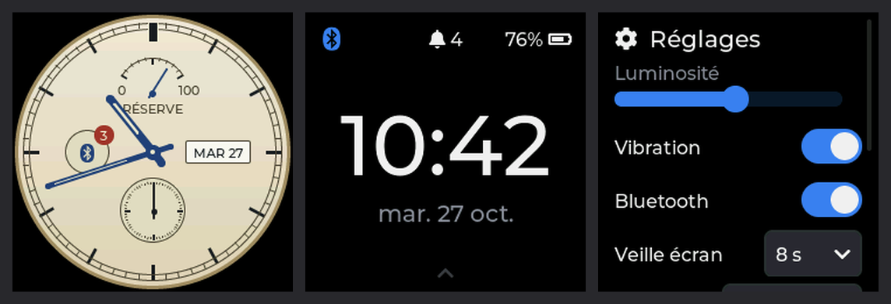
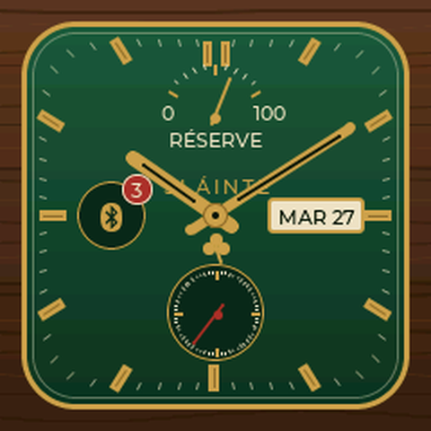
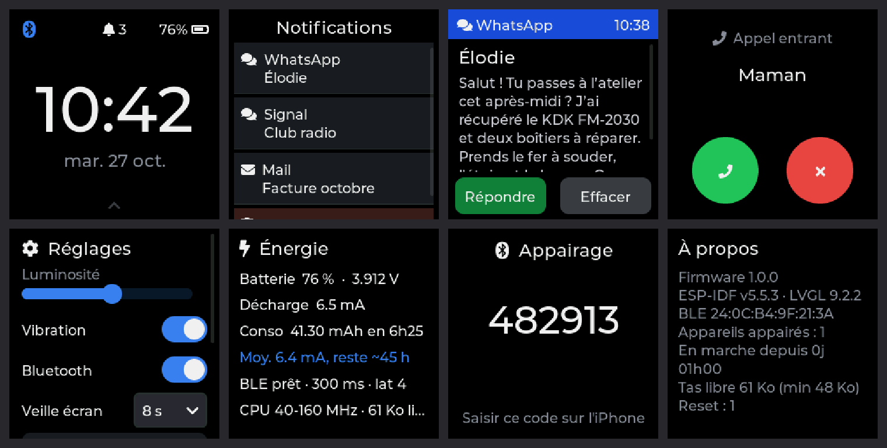
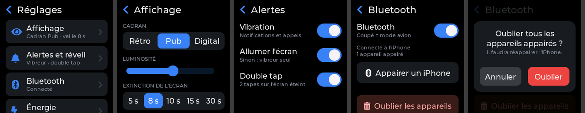

# twatch-idf — firmware T-Watch 2020 V1 (ESP-IDF + LVGL 9 + NimBLE)

Firmware écrit de zéro pour la **LilyGo T-Watch 2020 V1**, sans Arduino : notifications
iPhone via **ANCS**, heure synchronisée via **CTS**, interface tactile LVGL, cadran
analogique « montre ancienne » à complications. Priorités : stabilité, autonomie, finition.

| Cadrans | Écrans |
|---|---|
|   |  |

*(rendus PC de l'UI réelle avec des données factices)*

## Fonctionnalités

- Notifications iOS (ANCS) : liste triée, détail, actions iOS (*Effacer*, *Répondre*,
  *Accepter*/*Refuser* un appel), suppression synchronisée dans les deux sens, vibreur.
- Écran d'appel entrant dédié.
- **Lecture en cours** (Apple Media Service) : titre, artiste, album, progression, volume et
  commandes lecture/pause/précédent/suivant/volume, pour toute app audio iOS (Spotify,
  Musique, Deezer, podcasts…). AMS ne transmet pas la pochette.
- Heure et fuseau (DST compris) récupérés de l'iPhone (Current Time Service), RTC PCF8563
  en UTC comme référence.
- Trois cadrans : **Rétro** (cadran ivoire, aiguilles bleuies, réserve de marche =
  batterie, guichet date, petite seconde), **Pub** (carré plein écran, vert bouteille et laiton, harpe, jauge FUEL,
  enseigne OPEN/CLOSED pour la liaison iPhone) et **Numérique**.
- Appairage sécurisé LE Secure Connections + code à 6 chiffres, reconnexion automatique.
- Mode avion (Bluetooth coupé → vrai light sleep), écran **Énergie** (consommation moyenne
  mesurée par le compteur coulométrique de l'AXP202).
- Démarrage quasi instantané, coredump en flash en cas de crash.

Consommation mesurée : ~12,6 mA de moyenne **en utilisation** (≈ 30 h sur la batterie de
380 mAh d'origine). Voir [Autonomie](#autonomie).

---

## Flasher un binaire

Binaires fournis par la CI (onglet *Releases* ou *Actions*).

**Mise à jour sans câble (OTA Wi-Fi)** — le cas normal :

1. Montre : *Réglages › Mise à jour › Démarrer*. Le Bluetooth se coupe, la montre crée le
   réseau Wi-Fi **T-Watch-MAJ** et affiche son mot de passe (tiré au sort une fois, puis
   toujours le même : l'iPhone se reconnecte tout seul aux mises à jour suivantes).
2. iPhone ou PC : se connecter à ce réseau, ouvrir **http://192.168.4.1**, choisir
   `twatch2020v1-app.bin`, *Envoyer*.
3. La montre vérifie l'image (firmware T-Watch, SHA-256), l'active et redémarre.

L'image est écrite dans l'autre emplacement (`ota_0`/`ota_1`) : l'ancien firmware reste
intact jusqu'au bout. Au premier démarrage, le nouveau est « en essai » : s'il plante avant
30 s de fonctionnement, le bootloader revient automatiquement à l'ancien. Refus sous 30 %
de batterie hors USB ; abandon automatique après 5 min sans envoi.

**Première installation** (efface tout, y compris les appairages) :

```bash
esptool.py --chip esp32 -b 921600 write_flash 0x0 twatch2020v1-full.bin
```

**Par USB en gardant les appairages** (ou migration depuis une version sans OTA) :

```bash
esptool.py --chip esp32 -b 921600 write_flash \
  0x1000 bootloader.bin 0x8000 partition-table.bin \
  0x10000 ota_data_initial.bin 0x20000 twatch2020v1-app.bin
```

(`ota_data_initial.bin` remet le démarrage sur `ota_0`, là où le `.bin` est écrit.)

## Compiler

```bash
pio run -t upload -t monitor        # PlatformIO
# ou
idf.py build flash monitor          # ESP-IDF 5.5.6
```

- **ESP-IDF 5.5.6 obligatoire** (forcé via `platform_packages` dans `platformio.ini`).
  Avec ESP-IDF 5.5.3 (celui de `espressif32@6.13.0`), le contrôleur BT de l'ESP32
  (`libbtdm 045a658`) fait mourir la liaison iPhone en supervision timeout (0x208) juste
  après le chiffrement : appairage impossible. Le contrôleur d'IDF 5.5.6 (`919c7f4`)
  corrige le problème. Vérifier au boot : `BTDM_INIT: BT controller compile version [919c7f4]`.
- LVGL 9.2.2 est récupéré par le gestionnaire de composants ESP-IDF (`main/idf_component.yml`).
- Après toute modif de `sdkconfig.defaults` : supprimer `sdkconfig*` (sauf `.defaults`) puis rebuild.
- Coredump : `esp-coredump info_corefile build/twatch.elf` après un crash.
- Polices : `tools/gen_fonts.sh` (lv_font_conv).

## Appairage iPhone

1. Montre : glisser ← → *Réglages* → **Appairer un iPhone**.
2. iPhone : *Réglages › Bluetooth* → **T-Watch**.
3. Saisir sur l'iPhone le **code à 6 chiffres affiché sur la montre**.
4. Accepter « Autoriser les notifications » (la montre réessaie pendant ~1 min).

Si l'iPhone oublie la montre, elle efface son propre bond et relance un appairage propre.

## Utilisation

| Où | Geste / bouton | Effet |
|---|---|---|
| Cadran | ↑ | Liste des notifications |
| Cadran | ← | Réglages |
| Cadran | ↓ | Lecture en cours |
| Partout | → | Retour |
| Écran éteint | double tap | Allume l'écran (comme le bouton) |
| Bouton (écran éteint) | appui court | Allume l'écran (sur la dernière notif non vue en mode discret) |
| Bouton (hors cadran) | appui court | Retour cadran |
| Bouton (sur cadran) | appui court | Éteint l'écran |
| Bouton | 4 s | Coupure matérielle AXP202 |

Réglages (← depuis le cadran) : un accueil par catégories (dont **Mise à jour**) avec résumé de l'état, puis
**Affichage** (cadran Rétro/Pub/Digital, luminosité, extinction), **Alertes** (vibreur,
allumage sur notif — sinon mode discret —, double tap), **Bluetooth** (mode avion,
appairage, « Oublier les appareils » derrière une confirmation), **Énergie**, **À propos**.
Retour par l'en-tête « ‹ » ou en glissant vers la droite.



---

## Autonomie

**Sur ESP32 « classique », le light sleep est impossible tant que le contrôleur BLE est
actif** sans quartz 32 kHz externe (absent de la T-Watch 2020) : le contrôleur garde un
verrou `ESP_PM_NO_LIGHT_SLEEP`. C'est vrai quel que soit le framework. Le firmware joue donc
sur tout le reste :

| Levier | Réglage |
|---|---|
| DFS | CPU à **40 MHz** au repos ; **240 MHz** seulement pendant une interaction (toucher, animation), retour à 40 MHz après 1,5 s d'inactivité même écran allumé |
| BLE | modem sleep + un seul passage en paramètres éco après la synchro ANCS : 150–300 ms, latence 4, timeout 6 s (règles Apple respectées) |
| Publicité | 160 ms pendant 30 s après déconnexion, puis ~1 s |
| Tâches | aucun timer périodique écran éteint : la tâche app dort jusqu'à un événement (max 60 s) ; tick LVGL lu à la demande |
| AXP202 | ADC limités à V/I batterie, LED de charge éteinte |
| Périphériques | BMA423 en suspend, PCF8563 CLKOUT coupé, ST7789 en SLPIN, FT6336 en mode monitor, GPIO inutilisés figés |
| Mode avion | contrôleur BT arrêté → **light sleep automatique** |

Écran **Énergie** : moyenne réelle depuis le dernier débranchement USB (« Moy. x mA, reste ~y h »).

Piste matérielle (non retenue) : un oscillateur 32,768 kHz sur 32K_XN (GPIO33) permettrait
le light sleep BLE connecté (`BTDM_CTRL_LPCLK_SEL_EXT_32K_XTAL` + `RTC_CLK_SRC_EXT_OSC`).

## Architecture

```
            ┌───────────── tâche hôte NimBLE (cœur 0) ─────────────┐
            │ ble.c   GAP, sécurité passkey, service batterie,       │
 iPhone ◄──►│         params éco, publicité                          │
            │ ancs.c  découverte ANCS+CTS, file de commandes,        │
            │         réassemblage Data Source (ancs_parse.c)        │
            └──────────┬───────────────────────────┬──────────────────┘
                       │ g_notif_queue (copie)     │ app_post(événement)
            ┌──────────▼───────────────────────────▼──────────────────┐
 AXP IRQ ──►│ tâche app (cœur 1) : seule propriétaire de LVGL          │
 (GPIO35)   │ main.c  boucle événements / lv_timer_handler / veille    │
            │ ui.c, face_classic.c   notif_store.c  tri+dédup+UTF-8    │
            │ display.c (ST7789 + FT6336)  power.c (AXP, DFS, vibreur) │
            └──────────────────────────────────────────────────────────┘
```

Règles de stabilité :

- **Un seul propriétaire par état** : LVGL et notifications → tâche app ; état ANCS →
  tâche hôte NimBLE. Échanges par files, pas de mutex LVGL.
- **Une seule procédure ATT en vol** côté ANCS, numéro de génération sur chaque callback.
- **Data Source réassemblé octet par octet**, testé sur PC (10 000 fragmentations aléatoires, ASan/UBSan).
- **Replay iOS** filtré par `EventFlagPreExisting` + déduplication par contenu (FNV-1a, TTL 5 min).
- **Texte iOS nettoyé** (UTF-8 tronqué, émojis, ZWJ…) avant LVGL.
- **IRQ AXP en niveau** : aucune IRQ perdue pendant un light sleep.

Bibliothèques : pas d'`esp_lvgl_port` (timer de tick + tâche dédiée = réveils permanents),
pas de lib AXP/BMA/FT (quelques registres suffisent), `esp_lcd` natif, `i2c_master` d'IDF 5.

## Pièges rencontrés

- **Contrôleur BT d'ESP-IDF 5.5.3** : liaison chiffrée perdue en 0x208 (voir *Compiler*).
- **Confidentialité « host based » de NimBLE** : reconnexion impossible après rotation de
  l'adresse privée de l'iPhone (~15 min, SMP timeout). Résolution laissée au contrôleur.
- **En cours d'investigation** : après des heures de fonctionnement, l'iPhone n'arrive
  parfois plus à se reconnecter ; couper/relancer le Bluetooth de la montre ne suffit pas,
  un redémarrage complet si. Pour le diagnostic sans PC : *À propos* affiche un journal BLE
  horodaté (connexions, adresse vue, chiffrement, déconnexions, publicité) et l'écran
  *Énergie* signale une publicité annoncée mais inactive.
- **`BT_NIMBLE_GATT_CLIENT` dépend de `BT_NIMBLE_ROLE_CENTRAL`** dans IDF 5.5 : désactiver le
  rôle central supprime silencieusement `ble_gattc_*`, donc ANCS.
- **Rails AXP202** : sur cette montre LDO3 alimente l'écran et LDO4 le tactile. Aucun rail
  n'est coupé. L'AXP garde ses registres tant que la batterie est branchée : un ancien
  firmware qui coupe un rail « contamine » les suivants.
- **Image complète à 0x0** : efface la NVS (appairages). Mettre à jour avec l'app seule à 0x10000.
- Dalle à l'envers sur certaines séries : `board.h` → `BOARD_PANEL_ALT=1`.
- Le signal TE du ST7789 n'est pas câblé : pas de synchro anti-tearing possible, d'où
  flash QIO 80 MHz, double tampon DMA de 60 lignes et animations courtes.

## Tests PC

```bash
host_tests/run.sh
```

Parseur ANCS, nettoyage UTF-8, stockage (dédup/tri/capacité), sous `-fsanitize=address,undefined`.

## Fichiers

| Fichier | Rôle |
|---|---|
| `main/main.c` | `app_main`, tâche app, boucle d'événements, veille écran |
| `main/ble.c` | NimBLE : GAP, sécurité, publicité, params éco, service batterie, mode avion |
| `main/ancs.c` / `ancs_parse.c` | client ANCS + CTS + AMS (`media.h`) ; réassemblage Data Source |
| `main/notif_store.c` | stockage, tri par date, dédup, nettoyage UTF-8 |
| `main/ui.c` / `face_classic.c` / `face_pub.c` | écrans LVGL, navigation ; cadrans analogiques |
| `main/display.c` | ST7789 (`esp_lcd`, SPI DMA), FT6336, glue LVGL, DFS écran allumé |
| `main/power.c` / `axp202.c` | PMIC, batterie (OCV + compensation IR), verrous PM, rétroéclairage, vibreur |
| `main/wclock.c` | PCF8563 (UTC), fuseau, resynchro de l'horloge système |
| `main/settings.c` | réglages NVS |
| `main/ota.c` | mise à jour Wi-Fi : point d'accès, page web, écriture OTA, validation / retour arrière |
| `main/fonts/` | polices générées (`tools/gen_fonts.sh`) |

## Pistes

- Réveil au poignet / double tape (config BMA423 à charger, ~150–500 µA).
- Historique de consommation en NVS.
- Répondre aux SMS : impossible via ANCS (seules les actions iOS positive/négative existent).

---

## Crédits

| Projet | Usage | Licence |
|---|---|---|
| [ESP-IDF](https://github.com/espressif/esp-idf) — Espressif | framework, drivers, `esp_lcd`, PM | Apache-2.0 |
| [Apache NimBLE](https://github.com/apache/mynewt-nimble) (via ESP-IDF) | pile BLE hôte | Apache-2.0 |
| [LVGL](https://github.com/lvgl/lvgl) 9.2 | interface graphique | MIT |
| [lv_font_conv](https://github.com/lvgl/lv_font_conv) | conversion des polices | MIT |
| [Montserrat](https://github.com/JulietaUla/Montserrat) — Julieta Ulanovsky | polices de texte (`main/fonts/`) | SIL OFL 1.1 |
| [Font Awesome Free](https://fontawesome.com) | icônes (`main/fonts/`) | SIL OFL 1.1 (polices) |
| [TTGO_TWatch_Library](https://github.com/Xinyuan-LilyGO/TTGO_TWatch_Library) — LilyGo | référence brochage et périphériques | MIT |
| [My-TTGO-Watch](https://github.com/sharandac/My-TTGO-Watch) — sharandac | inspiration (gestion d'énergie, BLE) ; aucun code repris | GPL-3.0 |
| Apple — *ANCS Specification*, *Accessory Design Guidelines* | protocole ANCS, paramètres de connexion | — |

Code du firmware sous licence MIT (voir `LICENSE`).
