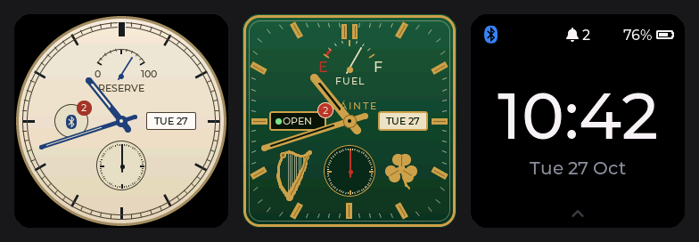
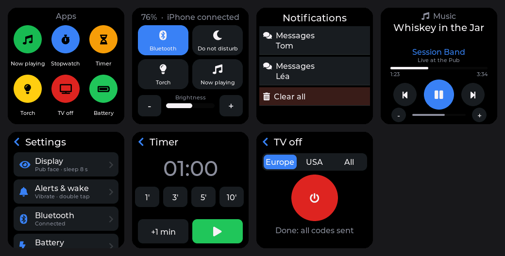

# twatch-idf — iPhone companion firmware for the LilyGo T-Watch 2020 V1

**[Français](README.fr.md)** · English

A from-scratch firmware for the **LilyGo T-Watch 2020 V1** written in pure **ESP-IDF 5.5**
(no Arduino), with **LVGL 9** and **NimBLE**. It turns the watch into a quiet, long-lasting
iPhone companion: notifications, calls, now playing, time sync — plus a few handy apps.

Priorities, in order: **stability**, **battery life**, **finish**.




*(PC renders of the real UI with sample data)*

> Not affiliated with, endorsed by or sponsored by Apple Inc. or LilyGo (Shenzhen Xinyuan
> Electronic Technology). See [Trademarks and disclaimer](#trademarks-and-disclaimer).

---

## Features

- **iPhone notifications** (Apple Notification Center Service, no app to install on the
  phone): sorted list, detail view, iOS actions (*Clear*, *Reply*, *Accept*/*Decline* a call),
  removal synced both ways, vibration.
- **Incoming call** screen.
- **Now playing** (Apple Media Service): title, artist, album, progress, volume, play/pause,
  previous/next, volume — works with any iOS audio app. (AMS does not provide artwork.)
- **Time and time zone** (DST included) from the iPhone (Current Time Service); the PCF8563 RTC
  keeps UTC.
- **Three watch faces**: *Retro* (ivory dial, blued hands, battery as power reserve, date
  window, small seconds), *Pub* (full-screen square, bottle green and brass, harp, FUEL gauge,
  OPEN/CLOSED sign for the phone link) and *Digital*.
- **Apps**: launcher with *Stopwatch* (laps), *Timer* (beeps and vibrates even with the screen
  off, then reopens), *Torch* (white/red), *Carrier* (square-wave RF test signal, 5–125 MHz, from the ESP32 audio PLL) and *TV off* (switches off most TVs through the IR
  LED, Europe/USA code sets). A running stopwatch or timer keeps the focus: the screen turns
  off on it and wakes back to it. A small app framework lets you add one in a single file.
- **Quick controls**: Bluetooth, **Do not disturb**, torch, now playing, brightness.
- **French or English UI**, switched instantly without a restart.
- **Over-the-air updates** from the iPhone over Wi-Fi (the watch becomes an access point),
  with automatic rollback, plus **going back to the previous version** from the watch.
- Secure pairing (LE Secure Connections + 6-digit passkey), automatic reconnection.
- **Energy screen**: average consumption measured by the AXP202 coulomb counter, previous
  discharge, and an **adaptive battery gauge** that learns the real capacity of a worn
  battery.
- Airplane mode (Bluetooth off → real automatic light sleep).
- Uses the 8 MB PSRAM (4 MB mapped) for large allocations.
- Near-instant boot; core dump to flash on crash; on-watch BLE diagnostic log.

**Measured consumption:** about **7.7 mA in standby** and 8–9 mA on average in real use
(≈3 % screen-on time, iPhone connected), i.e. roughly two days on a healthy 380 mAh battery.

---

## Gestures

| Where | Gesture / button | Action |
|---|---|---|
| Watch face | swipe ↑ | Notifications (close: ↓ or →) |
| Watch face | swipe ↓ | Quick controls (close: ↑ or →) |
| Watch face | swipe ← | Apps: Now playing, Stopwatch, Timer, Torch, TV off, Carrier, Battery, Settings |
| Watch face | long press | Choose the watch face |
| Anywhere else | swipe → or « ‹ » | Back to where you came from |
| Screen off | double tap | Wake up (on the last unseen notification in silent mode) |
| Button, screen off | short press | Wake up |
| Button, not on the face | short press | Back to the watch face |
| Button, on the face | short press | Screen off |
| Button | hold 4 s | Hardware power-off (AXP202) |

**Do not disturb**: notifications neither vibrate nor wake the screen and wait in the list;
calls still ring. A moon shows on the watch face.

**Settings** (← then *Settings*): *Display* (face, brightness, timeout, language), *Alerts &
wake* (vibration, wake on notification or silent mode, double tap, speaker test),
*Bluetooth* (airplane mode, pairing, *Forget devices* behind a confirmation), *Battery*,
*About*, *Update*.

---

## Getting started

### 1. Flash it once over USB

Download `twatch2020v1-full.bin` from the [Releases](../../releases) page, then:

```bash
esptool.py --chip esp32 -b 921600 write_flash 0x0 twatch2020v1-full.bin
```

This erases everything (including pairings). Later updates go over Wi-Fi.

### 2. Pair the iPhone

1. Watch: swipe ← → *Settings* → *Bluetooth* → **Pair an iPhone**.
2. iPhone: *Settings › Bluetooth* → **T-Watch**.
3. Type the **6-digit code shown on the watch** on the iPhone.
4. Accept *Allow notifications* (the watch retries for about a minute).

If the iPhone forgets the watch, the watch erases its own bond and starts a clean pairing.

### 3. Update over Wi-Fi (no cable)

1. Watch: *Settings › Update › Start*. Bluetooth turns off; the watch creates the Wi-Fi
   network **T-Watch-OTA** and shows its password in large digits (drawn once, then always
   the same, so the iPhone rejoins by itself next time).
2. iPhone or computer: join that network, open **http://192.168.4.1** (French or English,
   following the browser), choose `twatch2020v1-app.bin`, *Send*.
3. The watch checks the image (T-Watch firmware, SHA-256), activates it and restarts.

The image is written to the other slot (`ota_0`/`ota_1`): the running firmware stays intact
until the end. A new image is "on trial" at first boot: if it crashes within 30 s, the
bootloader goes back to the previous one. Refused below 30 % battery unless on USB; gives up
after 5 minutes without an upload.

**Going back**: *Settings › Update › Go back to x.y.z* boots the previous firmware (after a
confirmation and a full image check). Settings and pairing are kept.

More: [building, flashing and tests](docs/en/building.md).

---

## Documentation

| | English | Français |
|---|---|---|
| Building, flashing, tests | [docs/en/building.md](docs/en/building.md) | [docs/fr/building.md](docs/fr/building.md) |
| Architecture, power, battery gauge | [docs/en/architecture.md](docs/en/architecture.md) | [docs/fr/architecture.md](docs/fr/architecture.md) |
| Hardware notes (pins, power rails, pitfalls) | [docs/en/hardware.md](docs/en/hardware.md) | [docs/fr/hardware.md](docs/fr/hardware.md) |
| Writing apps, translating | [docs/en/apps-and-i18n.md](docs/en/apps-and-i18n.md) | [docs/fr/apps-and-i18n.md](docs/fr/apps-and-i18n.md) |
| Changes | [CHANGELOG.md](CHANGELOG.md) | |
| Contributing | [CONTRIBUTING.md](CONTRIBUTING.md) | |

---

## License

Firmware source code: **MIT** (see [LICENSE](LICENSE)).

Exception: [`components/tvbgone/`](components/tvbgone/) (infrared power-code database and
transmitter, used by the *TV off* app) stays under **CC BY-SA 4.0**, as licensed by its
authors. Firmware binaries that include it therefore contain CC BY-SA 4.0 material; build
with `TW_NO_TVOFF=1` to leave it out entirely.

Third-party components and their licenses: [THIRD_PARTY_NOTICES.md](THIRD_PARTY_NOTICES.md).

## Credits

- [ESP-IDF](https://github.com/espressif/esp-idf) (Espressif), [Apache NimBLE](https://github.com/apache/mynewt-nimble),
  [LVGL](https://github.com/lvgl/lvgl) and [lv_font_conv](https://github.com/lvgl/lv_font_conv).
- [Montserrat](https://github.com/JulietaUla/Montserrat) font by Julieta Ulanovsky;
  [Font Awesome Free](https://fontawesome.com) icons.
- [TTGO_TWatch_Library](https://github.com/Xinyuan-LilyGO/TTGO_TWatch_Library) (LilyGo):
  pinout, peripherals and schematics used as reference.
- [My-TTGO-Watch](https://github.com/sharandac/My-TTGO-Watch) (sharandac): inspiration for
  power management and BLE; no code copied.
- TV-B-Gone® power codes by Mitch Altman and Limor Fried, Arduino port by Ken Shirriff,
  [ESP-IDF component](https://github.com/pedrominatel/esp-components/tree/main/tv-b-gone) by
  Pedro Minatel.
- Apple's public *ANCS*, *AMS* and *Accessory Design Guidelines* specifications.

## Trademarks and disclaimer

iPhone, iOS and Apple Watch are trademarks of Apple Inc. T-Watch, LilyGo and TV-B-Gone are
trademarks of their respective owners. They are used here only to
describe compatibility and origin; this project is independent and is not affiliated with,
endorsed or sponsored by any of them. It is not an MFi ("Made for iPhone") accessory.

The software is provided "as is", without warranty (see [LICENSE](LICENSE)). Flashing
firmware and handling lithium batteries is at your own risk. Use *TV off* considerately.
