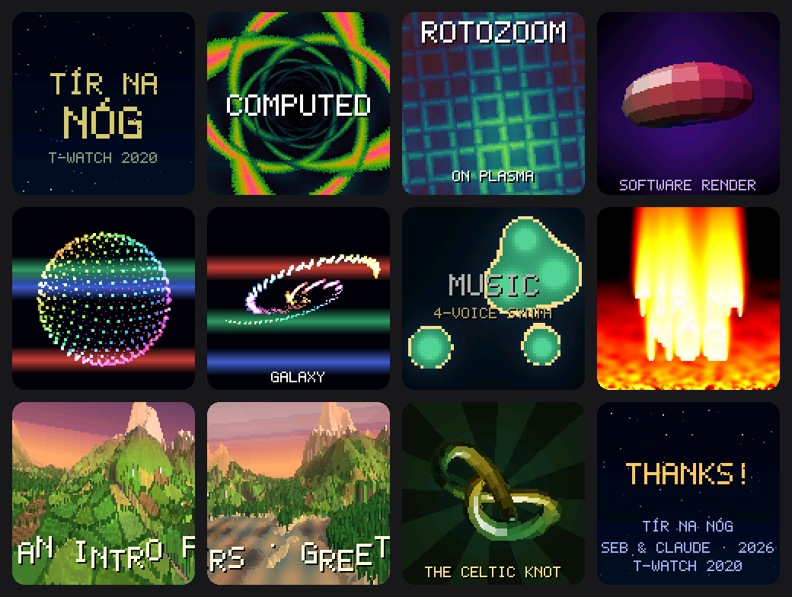

# Demo — "Tír na nÓg"

[Français](../fr/demo.md) · **English**

A demoscene-style intro of about 2 minutes, entirely computed by the watch: not a single
stored image or sound. Stars, textures, 3D objects, landscape and music are computed on
every frame. The name is the Otherworld of Irish mythology, the "land of youth".

## What happens

| When | Scene | Music |
|---|---|---|
| 0:00 | accelerating starfield, "Seb & Claude present", ~900 particles form the title, explosion | arpeggio alone |
| 0:08 | endless textured tunnel (interlace), "100 % computed on the watch" | bass, hi-hats |
| 0:15 | rotozoom of the interlace over a plasma | verse |
| 0:23 | shaded 3D torus swelling on the kick drum | |
| 0:31 | a swarm of 700 dots becoming sphere, torus, cube then galaxy, over copper bars | chorus |
| 0:46 | metaballs and credits | bridge, pad |
| 0:54 | the title burns, the fire rises with the snare roll | build-up |
| 1:01 | flight over Ireland at sunset (see below), sine-scroller greetings | verse, chorus |
| 1:32 | 3D Celtic knot | finale, melody an octave up |
| 1:48 | back to the stars, "THANKS!", fade out | ending |

At the end: **tap** to play it again. While it runs, a tap **mutes or unmutes** (the tune
keeps running silently, the visuals stay in sync). **Swipe** to leave.

The screen stays on and the CPU at 240 MHz while the demo is shown; everything stops as soon
as you leave or turn the screen off with the button.

## The landscape

Invented at every launch (it is different each time), in the background during the first
scenes: multi-octave terrain with snowy massifs, winding rivers, lakes and beaches, patchwork
meadows bordered by hedges, ploughed and hay fields, forests, white farmhouses, moorland and
rock. It is lit by a low sun with **cast shadows**, haze rises towards the horizon, clouds
scroll in perspective, water reflects the sky and shimmers. The autopilot follows the valleys.
The same landscape is used by the **Soar** game ([guide](flight.md)).

## The music

A small tracker-style synth (`demo_synth.c`), 125 BPM, in A minor: 64 bars (verse Am – F –
C – G, chorus F – G – Em – Am, bridge Dm – Am – F – G). Melody as a 25 % square with an echo,
arpeggio and bass as 50 % squares, a pad of three slightly detuned triangles, kick as a
falling sine, snare and hi-hats from noise. Rendered at 16 kHz in its own task; it is also the
frame clock.

## How it is done

Frames are computed at 120×120 in an internal-RAM buffer, then doubled into a 240×240 canvas
in PSRAM that LVGL sends to the display.

- **Tunnel**: precomputed per-pixel angle, depth and shade tables; each frame is just a
  texture lookup and a cycling palette.
- **Rotozoom**: texture walked in fixed point along a rotated line, mixed with a plasma from
  sine tables.
- **Torus and knot**: meshes rotated on three axes, back faces culled, per-face lighting
  (diffuse + specular), far-to-near sort, scanline-filled triangles. The knot is a 48 × 8
  facet tube around a trefoil knot.
- **Dots**: 700 points interpolated between two shapes, additive glow.
- **Metaballs**: five-source field computed at 60×60, golden iso-lines.
- **Fire**: the classic automaton (average of the neighbours below), the text is the hearth.
- **Landscape**: column-by-column "voxel space", heights and colours smoothed in the
  foreground — see [the architecture](architecture.md).
- **Text**: a tiny home-made 5×7 font, accents drawn.
