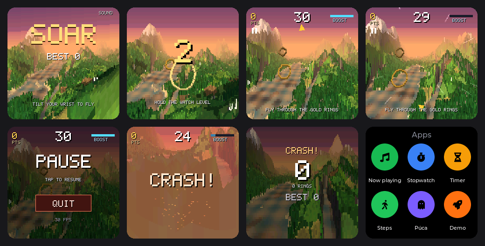

# Soar — the flying game

[Français](../fr/flight.md) · **English**

Fly over Ireland at sunset by tilting your wrist, and pass through **gold rings** before the
clock runs out. The landscape is invented at every launch (see the [Demo](demo.md)): never the
same course twice.

## Playing

1. On opening, the watch builds the world (a few seconds, progress bar), then the title
   screen flies over the landscape on autopilot and shows your **best score**.
2. **Tap** to take off. During the countdown, hold the watch as if reading the time: that pose
   becomes neutral.
3. **Tilt left / right**: turn (the plane banks). **Tilt towards you / away**: climb / dive.
4. **Tap**: boost (×1.7 for 1.2 s); the *BOOST* gauge refills in 4 s.
5. **Tap the score corner** (top left, under the ⏸ sign): pause, with a **QUIT** button and
   the frame rate. Tap anywhere else to resume.

## Rules

- The clock starts at **25 s**. Each ring gives back **+5 s** (+4 s from the 10th, +3 s from
  the 25th) and speeds the plane up a little.
- Rings chained less than 6 s apart raise the **combo**: a ring is worth as many points as the
  current combo.
- A gold arrow at the screen edge points to the next ring when it is out of view; the two
  after it show darker.
- A ring left far behind: **−3 s**, combo lost, and a new course starts ahead.
- **Hitting the terrain** (or the water): crash. *PULL UP!* flashes when you skim the ground.
- The game ends on a crash or when the clock hits zero; the **best score** is kept.

Music and sound effects (ring, boost, countdown, crash) come from the same synth as the demo;
mute by tapping *SOUND* top right on the title screen. The screen stays on and the CPU at
240 MHz while playing; leaving the app abandons the game. Nothing interrupts the game:
notifications received meanwhile go to the list, without a banner or vibration (calls still
come through).

## How it is done

The terrain is rendered at 160×120 into an internal-RAM buffer, widened ×1.5 with doubled
rows on screen (voxel space is made of columns, so horizontal resolution matters most). Each
column is first computed into a small local buffer, then copied in one go; the map keeps
height and colour in the same 32-bit word, so one sample costs a single PSRAM read. To hide
rings behind hills, the renderer records for each column the top of the terrain at 16
distances (2.5 KB instead of a full depth buffer). The work is split between the ESP32's two cores:
the left half of the picture on core 0, the right half on core 1, at the same time. The picture bypasses LVGL: it goes straight to the display in 20-line strips built in
internal RAM (one is filled while the other is sent), with the interface (clock, score,
gauge, arrow, messages) drawn strip by strip at full resolution.
Effects: sun lens flare, speed lines while boosting, spark bursts, shake and red flash on a
crash.
