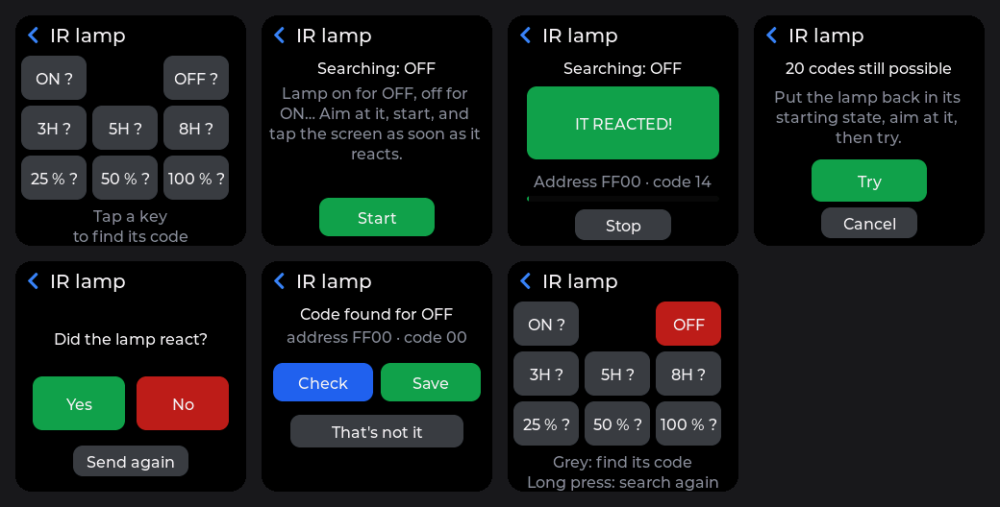

# IR lamp

[Français](../fr/irlamp.md) · **English**

An infrared remote for solar lamps sold with a small 8-key remote: **ON**, **OFF**, **3H / 5H /
8H** timers, **25 / 50 / 100 %** brightness. The watch sends through its infrared LED using the
**NEC** protocol, the one almost all of these remotes use.

## Finding the codes

The watch has no infrared receiver: it cannot read the original remote. So it finds the codes
itself, key by key.

1. Tap a grey key (for example **OFF ?**). Put the lamp in a state where that key will show:
   on for OFF, off for ON, at 100 % for 25 %…
2. Aim the watch at the lamp (the LED is on the edge, button side) and tap **Start**: the
   watch sends the 256 codes of an NEC address one by one, about 30 s per address, the most
   common addresses first.
3. As soon as the lamp reacts, tap **IT REACTED!** The codes sent in the last 2.5 seconds are
   the suspects (about twenty).
4. **Halving search**: put the lamp back in its starting state (with its remote), tap **Try**,
   then answer **Yes** or **No** depending on whether the lamp reacted. Each answer halves the
   suspects: after 4 or 5 tries only one is left.
5. **Check** sends the code found again, **Save** keeps it. *That's not it* resumes the sweep
   right after.

Once one key is known, the next ones go much faster: the watch only sweeps the lamp's address,
starting from the neighbouring codes (on these remotes, keys often have consecutive codes).

Start with **OFF** (or **ON**): it is the most visible. Timers do not always show; some lamps
blink to confirm.

## Using it

A known key shows in colour: tapping it sends the code (twice, to be safe), with a short
vibration. **Long press** a key to search for it again or forget it. Codes are kept in memory.

If no address makes the lamp react, it probably uses another protocol than NEC: its codes will
have to be read with an infrared receiver (a TSOP38238 on an ESP32 with IRremoteESP8266's
*IRrecvDumpV2* example, for instance).
