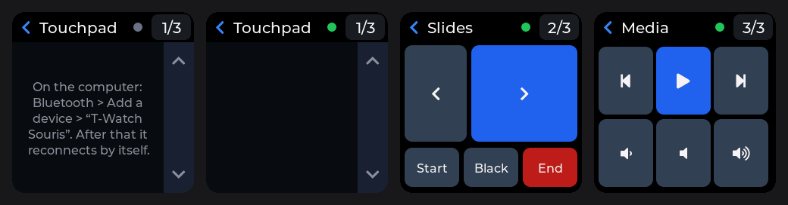

# Mouse

[Français](../fr/mouse.md) · **English**

The watch becomes a **Bluetooth** touchpad, presentation clicker and media remote for a
computer, a tablet or an iPhone (iOS: pointer through AssistiveTouch). It works with Windows, macOS, Linux, Android and ChromeOS, with no driver or software
to install.

## First time

1. Open the **Mouse** app: the watch leaves the iPhone and becomes "**T-Watch Souris**". The dot
   at the top is grey.
2. On the computer: *Bluetooth* › *Add a device* › **T-Watch Souris**.
3. The dot turns orange (connecting), then green (ready).

After that, the computer reconnects by itself a few seconds after the app is opened.

Leaving the app (back button, or the watch button) turns it back into the watch and the iPhone
reconnects: notifications received meanwhile are still on the phone. If airplane mode was on,
Bluetooth stays off afterwards. The screen stays on while in use.

## Three pages

Tap **1/3** top right for the next page.

**Touchpad**
- drag: moves the pointer. The faster the finger, the further the pointer goes.
- tap: click.
- long press: right click (with a vibration).
- tap then immediately press and drag: drag and drop. Two quick taps make a double click.
- right-hand strip (arrows): scroll.

**Slides** (PowerPoint, Keynote, Google Slides, PDF viewers…)
- big ◀ and ▶: previous and next slide (keyboard arrows).
- *Start* (F5), *Black* (B: black screen), *End* (Esc).

**Media**
- previous track, play/pause, next track.
- volume − and +, repeated while held, and mute.

## How it is done

Mouse mode is another Bluetooth identity: another address, the name "T-Watch Souris", the
"mouse" appearance. Its services are HID over GATT (mouse, keyboard and media reports), plus
device information and battery, and the iPhone notification service is absent. So the iPhone
never sees a mouse, and the pairing with the computer is separate from the phone's.

Pairing is "Just Works", with no code, and without an identity key (IRK): the normal watch's,
already known to the iPhone, would make it refuse this second device. If it fails, the
Bluetooth log (About) shows the step and the error code ("souris : …" lines). The link asks for an 11.25–27.5 ms interval
(Apple's HID rules) for responsiveness, with a latency of 4 so the radio sleeps when nothing moves. The touch screen is
read every 10 ms while in the app, instead of 33.
