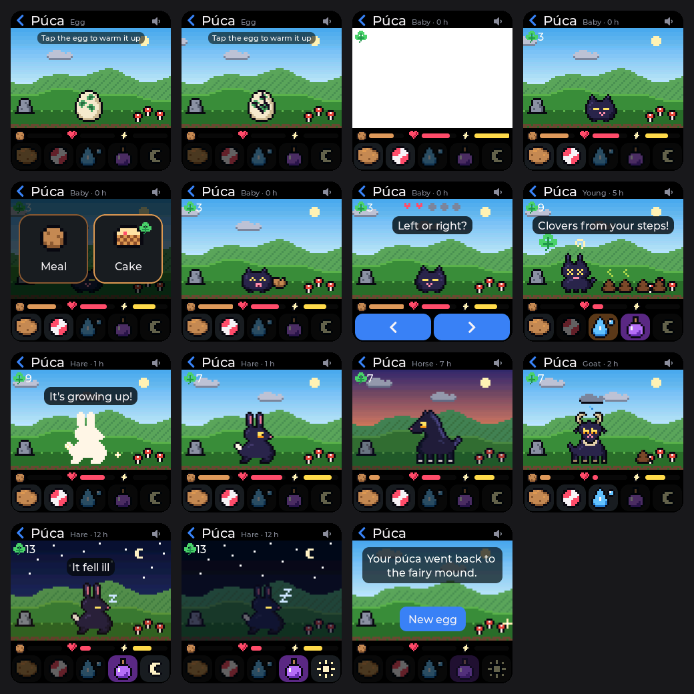

# Púca — the virtual pet

[Français](../fr/puca.md) · **English**

The *púca* is a mischievous shape-shifting spirit of Irish folklore: hare, horse, goat… The
**Púca** app makes it a little pixel-art companion to hatch, feed, entertain and heal. Its
adult form depends on how you look after it.

## Screen

| Where | What |
|---|---|
| Top | stage and age (*Baby · 5 h*, *Horse · 4 d*), sound effects on/off (tap the speaker) |
| Scene | sky following the time and season (dawn and dusk at the real sunrise and sunset, starry night), the púca wandering about, its droppings; shamrocks top left |
| Gauges | fullness (potato), mood (heart), energy (bolt) |
| Buttons | **feed**, **play**, **clean**, **heal**, **light** |

## Its life

1. **The egg**: tap it six times to warm it up; it cracks, then hatches.
2. **Baby** for 24 h, **young** until 72 h, then **adult**. Each change gets a little show
   (the two silhouettes swap, flash of light).
3. **Adult form**, from the average care since hatching:
   - **hare** — well cared for (≥ 60 %) and you walk a lot (≥ 5000 steps a day on average);
   - **horse** — well cared for;
   - grumpy **goat** — neglected.
4. It **falls asleep by itself at 10 pm** and wakes at 7 am. From sunset (or 8 pm) the moon
   button **puts it to bed earlier**, light off. With the light off it rests better; left on,
   it sleeps badly. Turning the light back on before 10 pm wakes it up. The light comes back on
   by itself in the morning.

Nothing runs in the background: when you open the app, its life since your last visit is
computed in one go, in 5-minute steps (up to 7 days). No battery cost.

## Looking after it

| Action | Effect |
|---|---|
| **Feed › Meal** (potato) | fullness +35 %; refused when not hungry. Three hours later… a dropping |
| **Feed › Cake** | mood +25 %, costs one **shamrock**; no more than three in two hours |
| **Play**: *left or right?* | five rounds: guess which way it will look. 3 or more right: mood +30 % and **one shamrock**. A bit tiring; not when sick or exhausted |
| **Clean** | removes droppings (the button lights up from two) |
| **Heal** (potion) | cures it; the button turns purple when it is sick |
| **Light** (moon) | in the evening: put it to bed; asleep: light off or on |
| **Pet it** (tap the púca) | little hop and a heart |

**Shamrocks**: one per 1000 steps of the day (step counter on in *Settings › Motion*), one per
game won.

**What makes it sick**: staying hungry for 4 h, or among three droppings for 3 h. When sick,
mood and energy drop faster and a swirl spins above its head.

**If abandoned** (hungry and unhappy for 48 h in a row), it goes back to the fairy mound: a new
egg awaits.

Gauges go down during the day: fullness empties in about ten hours, mood a bit slower. At night
hunger grows much more slowly and energy comes back.
