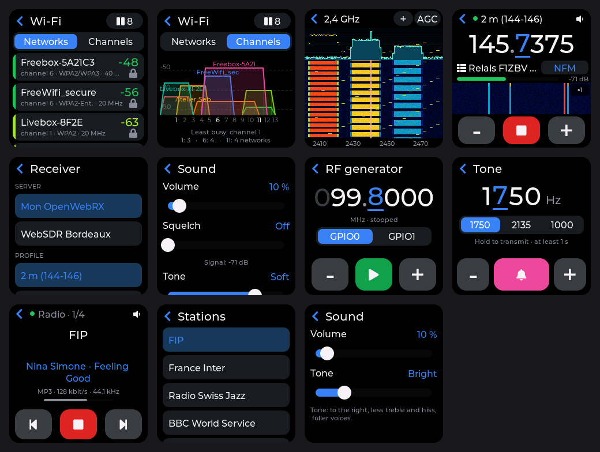
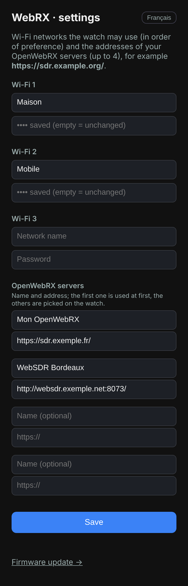

# Radio — listening to web radios

[Français](../fr/radio.md) · **English**

The **Radio** app plays web radios (Icecast, Shoutcast, public broadcasters' streams…) on
the watch speaker over Wi-Fi. Formats: **MP3** and **AAC / HE-AAC** (AAC+), over `http://`
or `https://`; **.m3u** and **.pls** playlists are followed. The current song (ICY metadata)
is shown when the station sends it.

## Setup (from the phone)

Same page as WebRX: open **Radio** and tap **Set up** (later: tap *Radio · 1/4* at the top →
*Wi-Fi and radios*). The watch creates the **T-Watch-OTA** network; join it on the phone and
open **http://192.168.4.1**. Enter up to 3 Wi-Fi networks and up to **12 web radios**
(optional name + stream address; *+ Add a radio* opens one more row), then **Save**: the
watch restarts straight into the app.

The address is the **audio stream**'s, not the station's website, for example
`https://icecast.radiofrance.fr/fip-hifi.aac`. A `.m3u` or `.pls` address ("listen in an
external player" links) works too. HLS (`.m3u8`), Ogg/Opus and FLAC streams are not
supported.

## Use

| Where | Action |
|---|---|
| Top bar, *Radio · i/n* | **stations** list; last row: *Wi-Fi and radios* (setup) |
| Top bar, speaker | **Sound** sheet: volume, tone |
| ◀◀ / ▶▶ | previous / next station |
| ■ / ▶ | stop / resume listening (Wi-Fi off when stopped) |
| Error message | tap: retry now |
| Side button | screen off, **playback continues**; press again to come back |
| Swipe → or ‹ | leave the app: playback stops, Bluetooth comes back |

- Playback resumes at the **last volume used** (15 % the first time, or if it was left at 0).
- **Tone** (5 steps, remembered): *Flat*, *Bright* (default), *Voice*, *Soft*, *Muffled* —
  to the right, less treble and fuller voices on the small speaker.
- The watch remembers the last station played.
- Below the title: format, bit rate, sample rate and buffer fill (≈ 8 s at 128 kbit/s).
  *CPU+* means the processor was raised to keep up with decoding.

## Power saving

- While playing, Wi-Fi is in *modem sleep* and the CPU is capped at 160 MHz; screen off, it
  drops to **80 MHz**. If decoding cannot keep up (high-rate HE-AAC), it goes back to 160 MHz
  as long as needed.
- Screen off, the **Wi-Fi transmit power** goes from 19.5 to 11 dBm when the received signal
  is good (above −65 dBm); it comes back up by itself if the signal weakens.
- The 128 KB buffer (in PSRAM) rides out Wi-Fi gaps.
- Bluetooth stays on, unless Wi-Fi lacks internal memory: it is then paused while playing
  (shown on screen) and comes back when you leave the app.

## Messages

| Message | Meaning |
|---|---|
| *Stream unreachable* | unknown address, server down or certificate rejected |
| *Stream refused by the server* (HTTP n) | the address is no longer valid (404) or the station refuses the connection |
| *Unsupported format* | neither MP3 nor AAC (type shown below) |
| *HLS streams are not supported* | the station only streams `.m3u8`: look for an Icecast/MP3 address |
| *Empty playlist* | the `.m3u`/`.pls` file holds no address |
| *Stream interrupted, resuming…* / *Wi-Fi lost* | automatic resume after a few seconds |

After a failure the watch retries on its own (5 s, then less and less often, up to 1 min).
