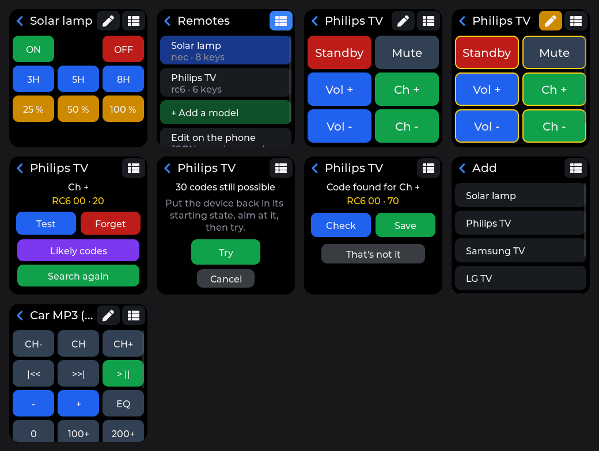

# Remote

[Français](../fr/remote.md) · **English**

Several infrared remotes in the watch: TV, lamp, amplifier… They are described as JSON,
editable from the phone, and the watch can search for a code it does not know by itself.
Protocols: **NEC**, **Samsung**, **RC5** and **RC6** (Philips), **Sony** (12, 15 and 20 bits).



## Using it

- The remote opened last is shown directly. Its name is at the top.
- **Tap a key** to send its code (short vibration). Volume keys **repeat while you keep your
  finger on them**, like a real remote.
- **Long press** a key: its details (protocol, address, code), with *Test*, *Forget*,
  *Likely codes* and *Search*.
- **≡** top right: the list of remotes. Tap one to switch to it, **long press** to delete one,
  **+ Add a model**, **Edit on the phone**.
- **✎**: setup mode. Tapping a key opens its details, even a volume key.
- **Back** returns to the grid; from the grid, it leaves the app.

A key whose code is unknown shows in grey with a "?": tapping it opens its details.

## Bundled models

| Model | Protocol | Keys |
|---|---|---|
| Solar lamp | NEC 00 | ON, OFF, 3H, 5H, 8H, 25 %, 50 %, 100 % |
| Philips TV | RC6 00 | Standby, Mute, Vol +/−, Ch +/− |
| Samsung TV | Samsung 07 | same |
| LG TV | NEC 04 | same |
| Sony TV | Sony 12-bit, 01 | same |
| Car MP3 | NEC 00 | the 21 keys of the small Chinese remote (reused by many lamps and LED strips) |

The TV codes are each brand's usual ones. They work on most models but not all: a key that
does not respond is fixed with *Likely codes*. On some Philips sets, channels are 4C/4D instead
of 20/21.

## Finding a code

The watch has no infrared receiver: it finds a code by sending it. Aim the device with the
watch edge on the button side, where the LED is.

- **Likely codes**: a halving search directly over the protocol's usual codes (Philips,
  Samsung, Sony, Chinese NEC remote…), minus those already used by other keys. Expect 4 to
  6 tries: put the device back in its starting state, **Try**, answer **Yes** or **No**.
- **Search for the code**: a sweep of all codes (256 per address, about 30 s).
  - If the remote already knows its protocol and address, the sweep starts next to the code
    of a known key.
  - Otherwise it tries the most common combinations: NEC, Samsung, RC6, RC5, Sony, then
    other NEC addresses.
  - Tap **IT REACTED!** as soon as the device responds, then do the halving search over the
    codes of the last 2.5 seconds.
- **Check**, then **Save**. A remote in *auto* protocol adopts the protocol of the first code
  found.

## Editing on the phone

*Edit on the phone* opens the watch's web page (Wi-Fi access point, as for the radios). It
shows the remotes' JSON, with one button per model to add. You can rename, reorder, add keys
or paste codes read elsewhere (IR receiver, set-top box, online code databases). Saving
restarts the watch into the app.

```json
{ "remotes": [
  { "name": "Living-room TV", "proto": "rc6", "addr": "00", "cols": 2,
    "keys": [
      { "label": "Standby", "code": "0C", "color": "red" },
      { "label": "Mute",    "code": "0D" },
      { "label": "Vol +",   "code": "10", "color": "blue", "repeat": true },
      { "label": "Source",  "code": "38" },
      { "label": "" },
      { "label": "Netflix", "w": 2 },
      { "label": "HDMI 1", "proto": "rc5", "addr": "00", "code": "3F" }
    ] } ] }
```

- `proto`: `nec`, `samsung`, `rc5`, `rc6`, `sony12`, `sony15`, `sony20`, or `auto` (to be
  found).
- `addr`, `code`: hexadecimal. For NEC, 2 digits mean the standard address (followed by its
  inverse) and 4 digits the 16-bit address as sent.
- `cols`: 1 to 4 columns. `w`: a key's width in columns.
- `{"label": ""}`: an empty cell. A key with no `code` is searched for from the watch.
- `repeat`: the key repeats while held.
- `color`: `green`, `red`, `blue`, `yellow`, `orange`, `purple` or `grey`.
- A key may have its own `proto` and `addr` (for example an HDMI input in RC5 on an RC6 TV).

At most 8 remotes of 30 keys.
