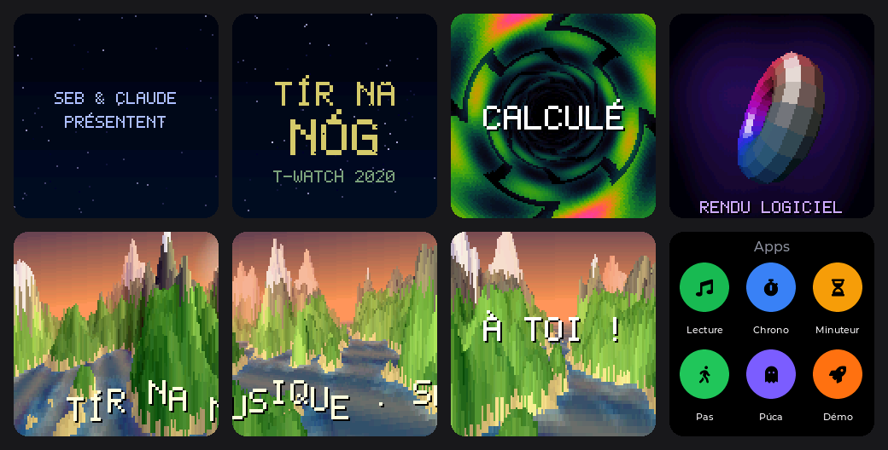

# Démo — « Tír na nÓg »

**Français** · [English](../en/demo.md)

Une petite intro façon démoscène (clin d'œil à *fr-08* de farbrausch) : environ 1 min 10
d'images et de musique, puis c'est vous qui pilotez. Rien n'est stocké : étoiles, texte,
textures, relief et musique sont calculés sur la montre au lancement et à chaque image. Le nom
est celui de l'autre monde de la mythologie irlandaise, la « terre de la jeunesse ».

## Déroulé

| Moment | Scène |
|---|---|
| 0 – 7 s | champ d'étoiles qui accélère, « Seb & Claude présentent », puis ~900 particules qui tourbillonnent et forment le titre, un reflet doré le balaie, explosion et éclair |
| 7 – 15 s | tunnel infini texturé : motif entrelacé, couleurs qui tournent, torsion, pulsations sur la batterie, « 100 % calculé sur la montre » |
| 15 – 31 s | tore 3D ombré (288 faces, tri du peintre, reflet spéculaire) qui gonfle sur la grosse caisse |
| 31 – 69 s | survol de collines au coucher du soleil : rivières, plages, prairies, roche, neige, soleil et halo ; le pilote automatique suit les vallées et s'incline dans les virages ; défilement sinusoïdal des salutations |
| ensuite | **« À toi ! »** : on pilote en penchant le poignet |

## Commandes

- **Penché à gauche / à droite** : virage (l'appareil s'incline).
- **Penché vers soi / vers l'avant** : monter / descendre.
- La position neutre suit lentement votre pose : tenez la montre comme pour lire l'heure.
- **Toucher l'écran** : couper / remettre le son (le morceau continue en silence).
- **Glisser** : quitter.

L'écran reste allumé et le processeur à 240 MHz tant que la démo est affichée ; elle s'arrête
(musique comprise) dès qu'on la quitte ou qu'on éteint l'écran avec le bouton. Le pilotage
utilise l'accéléromètre directement, même si le compteur de pas et le lever de poignet sont
coupés ; ils retrouvent leur réglage en sortant.

## La musique

Un petit synthétiseur 4 voies façon tracker (`demo_synth.c`), 125 BPM, en la mineur
(la m – fa – do – sol) : arpège seul, puis basse et charleston, roulement de caisse claire,
et la mélodie entre avec la batterie complète ; la seconde moitié tourne en boucle. Mélodie en
carré 25 %, arpège et basse en carré 50 %, grosse caisse en sinus qui plonge, caisse claire et
charleston au bruit. Rendu à 16 kHz dans sa propre tâche ; c'est aussi l'horloge de l'image,
si bien que les effets tombent pile sur les temps.

## Comment c'est fait

L'image est calculée en 120×120 dans un tampon en RAM interne, puis doublée dans un canevas
240×240 en PSRAM que LVGL envoie à l'écran.

- **Tunnel** : tables précalculées d'angle, de profondeur et d'ombre par pixel ; chaque image
  ne fait qu'une lecture de texture 128×128 et une palette 256 couleurs qui tourne.
- **Tore** : sommets tournés sur trois axes, faces cachées éliminées, éclairage par face
  (diffus + spéculaire), tri du plus loin au plus proche, remplissage de triangles par lignes.
- **Paysage** : carte de hauteurs 256×256 générée au lancement (bruit de valeur à 4 octaves,
  périodique pour que le monde se répète sans couture) et carte de couleurs ombrée selon la
  pente ; rendu « voxel space » colonne par colonne avec tampon de hauteur, brume vers
  l'horizon, roulis par décalage de l'horizon par colonne.
- **Texte** : petite police 5×7 maison, accents dessinés (aigu, grave, circonflexe).
