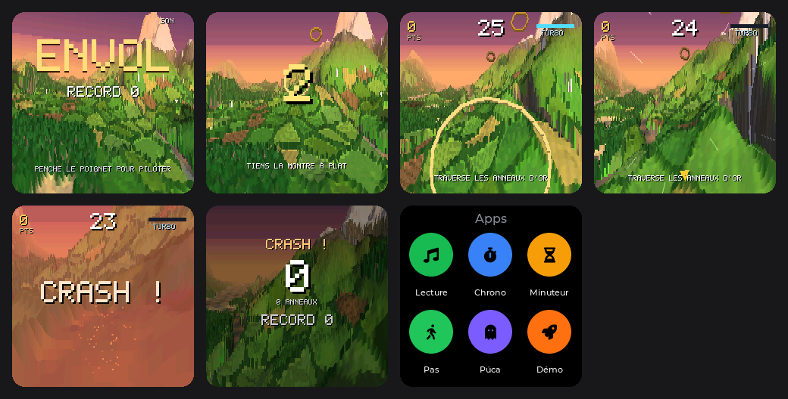

# Envol — le jeu de vol

**Français** · [English](../en/flight.md)

On survole l'Irlande au coucher du soleil en pilotant au poignet, et on traverse des
**anneaux d'or** avant la fin du chrono. Le paysage est inventé à chaque lancement (voir la
[Démo](demo.md)) : jamais deux fois le même parcours.

## Jouer

1. À l'ouverture, la montre crée le monde (quelques secondes, barre de progression), puis
   l'écran titre survole le paysage en pilote automatique avec votre **record**.
2. **Toucher l'écran** pour décoller. Pendant le compte à rebours, tenez la montre comme pour
   lire l'heure : cette pose devient le neutre.
3. **Penché à gauche / à droite** : virage (l'avion s'incline). **Penché vers soi / vers
   l'avant** : monter / descendre.
4. **Toucher l'écran** : turbo (×1,7 pendant 1,2 s), la jauge *TURBO* se recharge en 4 s.

## Règles

- Le chrono part de **25 s**. Chaque anneau traversé rend **+5 s** (+4 s à partir du 10e,
  +3 s à partir du 25e) et accélère un peu l'avion.
- Les anneaux enchaînés à moins de 6 s d'intervalle font monter le **combo** : un anneau vaut
  autant de points que le combo en cours.
- Une flèche dorée au bord de l'écran montre l'anneau suivant quand il est hors champ ; les
  deux suivants sont visibles en plus sombre.
- Un anneau laissé loin derrière : **−3 s**, combo perdu, et un nouveau parcours part devant.
- **Toucher le relief** (ou l'eau) : crash. *ALTITUDE !* clignote quand on rase le sol.
- Fin de partie au crash ou quand le chrono tombe à zéro ; le **record** est gardé.

Musique et bruitages (anneau, turbo, compte à rebours, crash) par le même synthétiseur que la
démo ; le haut-parleur se coupe en touchant *SON* en haut à droite de l'écran titre. L'écran
reste allumé et le processeur à 240 MHz pendant le jeu ; quitter l'app abandonne la partie.

## Comment c'est fait

Le relief est rendu en 240×120 (pleine largeur, lignes doublées à l'écran : le voxel space
est fait de colonnes, la résolution horizontale compte le plus), avec un tampon de profondeur
pour que les anneaux se cachent derrière les collines. L'interface (chrono, score, jauge,
flèche, messages) est dessinée ensuite à pleine résolution. Effets : reflet du soleil dans
l'objectif, lignes de vitesse en turbo, gerbes d'étincelles, secousse et éclair rouge au crash.
