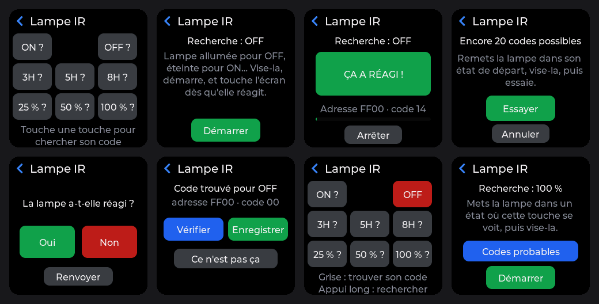

# Lampe IR

**Français** · [English](../en/irlamp.md)

Une télécommande infrarouge pour les lampes solaires vendues avec une petite télécommande à
8 touches : **ON**, **OFF**, minuteries **3H / 5H / 8H**, luminosité **25 / 50 / 100 %**.
La montre émet par sa LED infrarouge, au protocole **NEC**, celui de presque toutes ces
télécommandes.

## Trouver les codes

La montre n'a pas de récepteur infrarouge : elle ne peut pas lire la télécommande d'origine.
Elle cherche donc les codes elle-même, touche par touche.

1. Touche une touche grise (par exemple **OFF ?**). Mets la lampe dans un état où cette touche
   se verra : allumée pour OFF, éteinte pour ON, à 100 % pour 25 %…
2. Vise la lampe avec la montre (la LED est sur la tranche, côté bouton) et touche
   **Démarrer** : la montre envoie un à un les 256 codes d'une adresse NEC, environ 30 s par
   adresse, les adresses les plus courantes d'abord.
3. Dès que la lampe réagit, touche **ÇA A RÉAGI !** Les codes partis dans les 2,5 dernières
   secondes sont les suspects (une vingtaine).
4. **Recherche par moitiés** : remets la lampe dans son état de départ (avec sa
   télécommande), touche **Essayer**, puis réponds **Oui** ou **Non** selon que la lampe a
   réagi. Il reste deux fois moins de suspects à chaque réponse : en 4 ou 5 essais, il n'en
   reste qu'un.
5. **Vérifier** renvoie le code trouvé, **Enregistrer** le garde. *Ce n'est pas ça* reprend le
   balayage juste après.

Dès qu'une touche est connue, les suivantes vont beaucoup plus vite : la montre ne balaie plus
que l'adresse de la lampe, en partant des codes voisins (sur ces télécommandes, les touches ont
souvent des codes qui se suivent).

**Codes probables** : une fois une touche trouvée, ce bouton essaie directement, par moitiés,
les 21 codes de la télécommande chinoise « Car MP3 » (NEC, adresse 0x00), que reprennent
beaucoup de lampes solaires : pas de balayage, 4 ou 5 essais. Sur ce modèle, les touches
valent, rangée par rangée : 45 46 47 · 44 40 43 · 07 15 09 · 16 19 0D · 0C 18 5E · 08 1C 5A ·
42 52 4A.

Commence par **OFF** (ou **ON**) : c'est le plus visible. Les minuteries ne se voient pas
toujours ; certaines lampes clignotent pour confirmer.

## Utiliser

Une touche connue s'affiche en couleur : la toucher envoie le code (deux fois, par sécurité),
avec une petite vibration. **Appui long** sur une touche : son adresse et son code NEC s'affichent, avec de quoi la
chercher à nouveau ou l'oublier. Le bouton retour (ou glisser vers la droite) ramène à la
grille ; depuis la grille, il quitte l'app.
Les codes sont gardés en mémoire.

Si aucune adresse ne fait réagir la lampe, elle utilise sans doute un autre protocole que
NEC : il faudra relever ses codes avec un récepteur infrarouge (un TSOP38238 sur un ESP32 avec
l'exemple *IRrecvDumpV2* d'IRremoteESP8266, par exemple).
