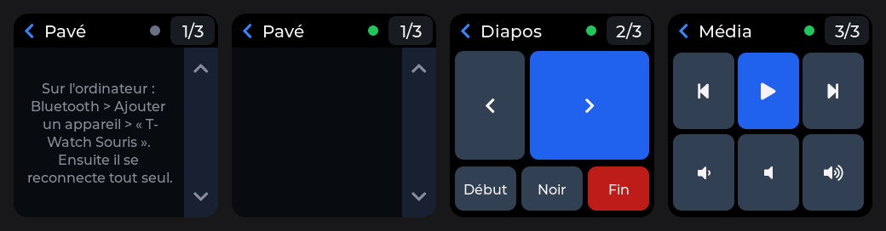

# Souris

**Français** · [English](../en/mouse.md)

La montre devient un pavé tactile, une télécommande de présentation et une télécommande
multimédia **Bluetooth** pour un ordinateur. Elle marche sous Windows, macOS, Linux, Android et
ChromeOS, sans pilote ni logiciel à installer.

## Première fois

1. Ouvrez l'app **Souris** : la montre quitte l'iPhone et devient « **T-Watch Souris** ». La
   pastille en haut est grise.
2. Sur l'ordinateur : *Bluetooth* › *Ajouter un appareil* › **T-Watch Souris**.
3. La pastille passe à l'orange (connexion), puis au vert (prête).

Ensuite, l'ordinateur se reconnecte tout seul quelques secondes après l'ouverture de l'app.

En quittant l'app (bouton retour, ou bouton de la montre), elle redevient la montre et l'iPhone
se reconnecte : les notifications reçues entre-temps sont toujours sur le téléphone. Si le mode
avion était actif, le Bluetooth reste ensuite coupé. L'écran reste allumé pendant l'utilisation.

## Trois pages

Touchez **1/3** en haut à droite pour passer à la page suivante.

**Pavé**
- glisser : déplace le pointeur. Plus le doigt va vite, plus le pointeur va loin.
- toucher : clic.
- appui long : clic droit (avec une vibration).
- toucher puis aussitôt appuyer et glisser : glisser-déposer. Deux touchers rapides font un
  double-clic.
- bande de droite (flèches) : défilement.

**Diapos** (PowerPoint, Keynote, Google Slides, lecteurs PDF…)
- ◀ et ▶ en grand : diapo précédente et suivante (flèches du clavier).
- *Début* (F5), *Noir* (B : écran noir), *Fin* (Échap).

**Média**
- piste précédente, lecture/pause, piste suivante.
- volume − et +, répété si l'on garde le doigt, et muet.

## Comment c'est fait

Le mode Souris est une autre identité Bluetooth : autre adresse, nom « T-Watch Souris »,
apparence « souris ». Les services sont HID over GATT (rapports souris, clavier et multimédia),
plus les informations d'appareil et la batterie, et le service de notifications iPhone est
absent. L'iPhone ne voit donc jamais de souris, et l'appairage avec l'ordinateur est séparé de
celui du téléphone.

L'appairage se fait en « Just Works », sans code. La liaison demande 7,5 à 15 ms d'intervalle
pour la réactivité, avec une latence de 4 pour que la radio dorme quand on ne bouge pas.
L'écran tactile est lu toutes les 10 ms pendant l'app, au lieu de 33.
