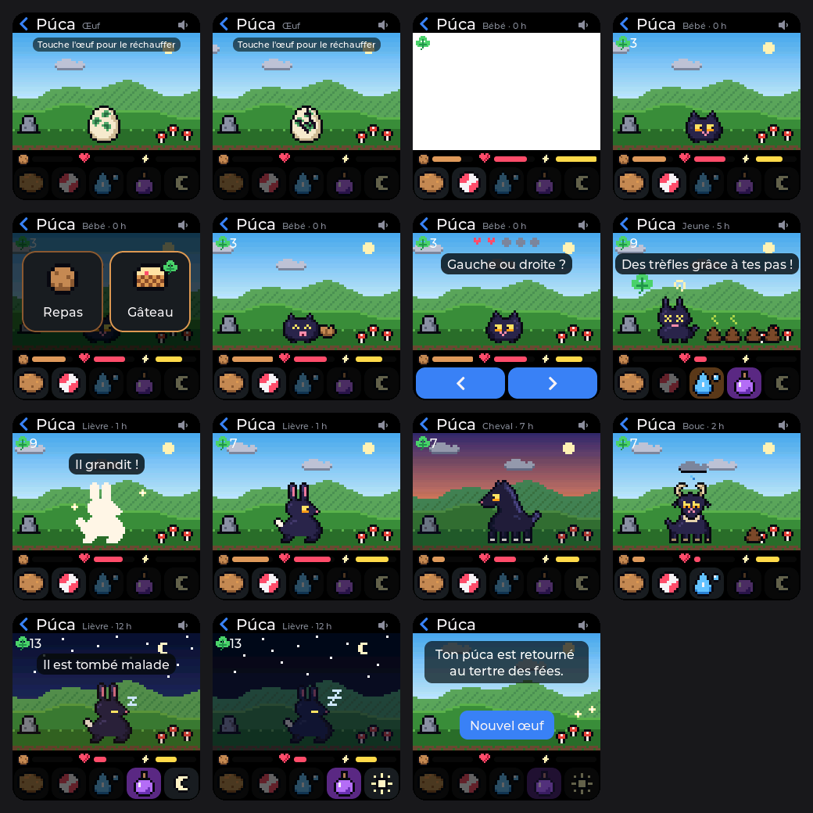

# Púca — l'animal virtuel

**Français** · [English](../en/puca.md)

Le *púca* est un esprit farceur du folklore irlandais qui change de forme : lièvre, cheval,
bouc… L'app **Púca** en fait un petit compagnon en pixel art à faire éclore, nourrir, distraire
et soigner. Sa forme adulte dépend de la façon dont tu t'en occupes.

## Écran

| Où | Quoi |
|---|---|
| En haut | stade et âge (*Bébé · 5 h*, *Cheval · 4 j*), son des effets (toucher le haut-parleur) |
| Scène | ciel qui suit l'heure et la saison (aube et crépuscule aux vrais lever et coucher du soleil, nuit étoilée), le púca qui se promène, ses crottes ; trèfles en haut à gauche |
| Jauges | satiété (pomme de terre), humeur (cœur), énergie (éclair) |
| Boutons | **nourrir**, **jouer**, **laver**, **soigner**, **lumière** |

## Sa vie

1. **L'œuf** : le toucher six fois pour le réchauffer ; il se fissure, puis éclot.
2. **Bébé** pendant 24 h, **jeune** jusqu'à 72 h, puis **adulte**. À chaque passage, une
   petite mise en scène (les deux silhouettes s'échangent, éclair de lumière).
3. **Forme adulte**, selon la moyenne des soins depuis l'éclosion :
   - **lièvre** — bien soigné (≥ 60 %) et tu marches beaucoup (≥ 5000 pas par jour en moyenne) ;
   - **cheval** — bien soigné ;
   - **bouc** ronchon — soins négligés.
4. Il **dort de 22 h à 7 h**. Lumière éteinte (bouton lune), il récupère mieux ; laissée
   allumée, il dort mal. Elle se rallume seule au réveil.

Rien ne tourne en tâche de fond : à l'ouverture de l'app, sa vie depuis ta dernière visite est
calculée d'un coup, par pas de 5 minutes (au plus 7 jours). Aucun coût sur la batterie.

## S'en occuper

| Action | Effet |
|---|---|
| **Nourrir › Repas** (pomme de terre) | satiété +35 % ; refusé s'il n'a pas faim. Trois heures plus tard… une crotte |
| **Nourrir › Gâteau** | humeur +25 %, coûte un **trèfle** ; pas plus de trois en deux heures |
| **Jouer** : *gauche ou droite ?* | cinq manches : devine de quel côté il va regarder. 3 réussies ou plus : humeur +30 % et **un trèfle**. Fatigue un peu ; impossible s'il est malade ou épuisé |
| **Laver** | enlève les crottes (le bouton se colore quand il y en a au moins deux) |
| **Soigner** (potion) | guérit ; le bouton devient violet quand il est malade |
| **Lumière** | la nuit seulement |
| **Le caresser** (toucher le púca) | petit bond et un cœur |

**Trèfles** : un trèfle par tranche de 1000 pas du jour (compteur de pas activé dans
*Réglages › Mouvement*), un trèfle par partie gagnée.

**Ce qui le rend malade** : rester affamé 4 h, ou au milieu de trois crottes 3 h. Malade, son
humeur et son énergie baissent plus vite et un tourbillon tourne au-dessus de sa tête.

**S'il est abandonné** (affamé et malheureux 48 h d'affilée), il retourne au tertre des fées :
un nouvel œuf t'attend.

Les jauges baissent pendant la journée : la satiété se vide en une dizaine d'heures, l'humeur en
un peu plus. La nuit, la faim se creuse beaucoup moins et l'énergie remonte.
