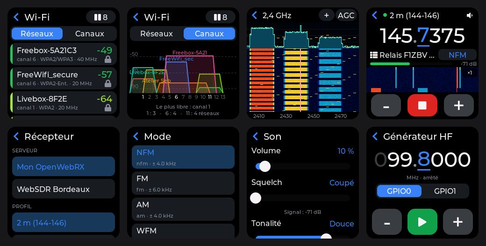
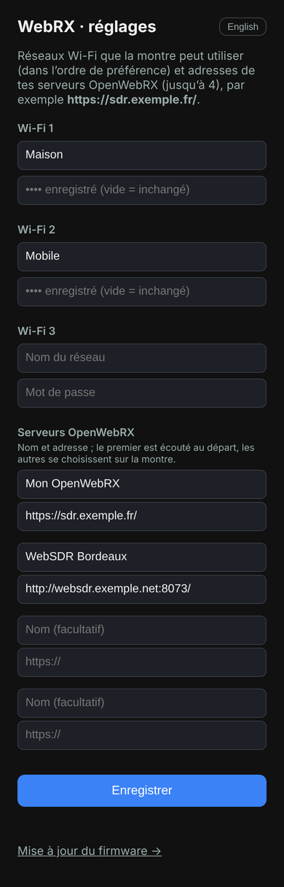

# Radio — écouter des webradios

**Français** · [English](../en/radio.md)

L'app **Radio** joue des webradios (Icecast, Shoutcast, flux de radios publiques…) sur le
haut-parleur de la montre, par le Wi-Fi. Formats : **MP3** et **AAC / HE-AAC** (AAC+), en
`http://` ou `https://` ; les listes de lecture **.m3u** et **.pls** sont suivies. Le titre en
cours (métadonnées ICY) s'affiche quand la station le diffuse.

## Réglages (depuis le téléphone)

Même page que pour WebRX : ouvrir **Radio** et toucher **Configurer** (plus tard : toucher
*Radio · 1/4* en haut → *Wi-Fi et radios*). La montre crée le réseau **T-Watch-OTA** ; sur le
téléphone, le rejoindre et ouvrir **http://192.168.4.1**. Saisir jusqu'à 3 réseaux Wi-Fi et
jusqu'à **12 webradios** (nom facultatif + adresse du flux ; *+ Ajouter une radio* ouvre une
ligne de plus), puis **Enregistrer** : la montre redémarre directement dans l'app.

L'adresse est celle du **flux audio**, pas celle du site de la radio, par exemple
`https://icecast.radiofrance.fr/fip-hifi.aac`. Une adresse en `.m3u` ou `.pls` (lien « écouter
dans un lecteur externe ») convient aussi. Les flux HLS (`.m3u8`), Ogg/Opus et FLAC ne sont pas
pris en charge.

## Utilisation

| Où | Action |
|---|---|
| Barre du haut, *Radio · i/n* | liste des **stations** ; dernière ligne : *Wi-Fi et radios* (réglages) |
| Barre du haut, haut-parleur | feuille **Son** : volume, tonalité |
| ◀◀ / ▶▶ | station précédente / suivante |
| ■ / ▶ | arrêter / reprendre l'écoute (Wi-Fi coupé à l'arrêt) |
| Message d'erreur | toucher : nouvel essai immédiat |
| Bouton latéral | écran éteint, **l'écoute continue** ; un nouvel appui y revient |
| Glisser → ou ‹ | quitter l'app : l'écoute s'arrête, le Bluetooth revient |

- L'écoute reprend au **dernier volume utilisé** (15 % la première fois, ou s'il était resté à 0).
- **Tonalité** (5 paliers, retenue) : *Neutre*, *Claire* (par défaut), *Voix*, *Douce*,
  *Sourde* — vers la droite, moins d'aigus, plus de corps aux voix sur le petit haut-parleur.
- La montre retient la dernière station écoutée.
- Sous le titre : format, débit, fréquence d'échantillonnage et remplissage de la mémoire
  tampon (≈ 8 s à 128 kbit/s). *CPU+* signale que le processeur a été relevé pour suivre le
  décodage.

## Économie d'énergie

- Pendant l'écoute, le Wi-Fi est en *modem sleep* et le processeur plafonné à 160 MHz ; écran
  éteint, il descend à **80 MHz**. Si le décodage ne suit plus (HE-AAC à fort débit), il
  remonte à 160 MHz le temps nécessaire.
- Écran éteint, la **puissance d'émission Wi-Fi** passe de 19,5 à 11 dBm quand le signal reçu
  est bon (au-dessus de −65 dBm) ; elle remonte d'elle-même si le signal faiblit.
- La mémoire tampon de 128 Ko (en PSRAM) absorbe les trous du Wi-Fi.
- Le Bluetooth reste actif, sauf si le Wi-Fi manque de mémoire interne : il est alors mis en
  pause pendant l'écoute (message à l'écran) et revient en quittant l'app.

## Messages

| Message | Signification |
|---|---|
| *Flux injoignable* | adresse inconnue, serveur éteint ou certificat refusé |
| *Flux refusé par le serveur* (HTTP n) | l'adresse n'est plus valable (404) ou la radio refuse la connexion |
| *Format non pris en charge* | ni MP3 ni AAC (type indiqué en dessous) |
| *Flux HLS non pris en charge* | la radio ne diffuse qu'en `.m3u8` : chercher une adresse Icecast/MP3 |
| *Liste de lecture vide* | le fichier `.m3u`/`.pls` ne contient aucune adresse |
| *Flux interrompu, reprise…* / *Wi-Fi perdu* | reprise automatique après quelques secondes |

Après un échec, la montre réessaie seule (5 s, puis de plus en plus espacé jusqu'à 1 min).
