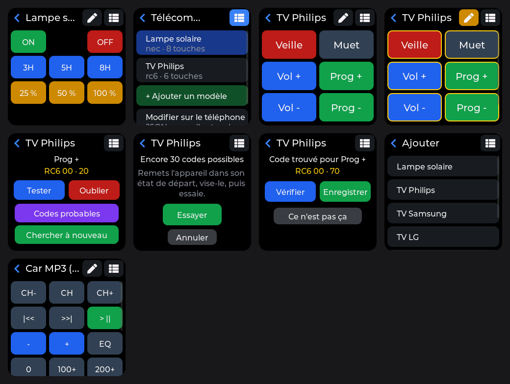

# Télécommande

**Français** · [English](../en/remote.md)

Plusieurs télécommandes infrarouges dans la montre : téléviseur, lampe, ampli… Elles sont
décrites en JSON, modifiable depuis le téléphone, et la montre sait chercher elle-même un code
qu'elle ne connaît pas. Protocoles : **NEC**, **Samsung**, **RC5** et **RC6** (Philips),
**Sony** (12, 15 et 20 bits).



## Utiliser

- La télécommande ouverte la dernière fois s'affiche directement. Son nom est en haut.
- **Toucher une touche** envoie son code (petite vibration). Les touches de volume se
  **répètent tant qu'on garde le doigt**, comme sur une vraie télécommande.
- **Appui long** sur une touche : sa fiche (protocole, adresse, code), avec *Tester*,
  *Oublier*, *Codes probables* et *Chercher*.
- **≡** en haut à droite : la liste des télécommandes. Toucher pour en changer, **appui long**
  pour en supprimer une, **+ Ajouter un modèle**, **Modifier sur le téléphone**.
- **✎** : mode réglage. Toucher une touche ouvre sa fiche, même une touche de volume.
- **Retour** ramène à la grille ; depuis la grille, il quitte l'app.

Une touche dont le code est inconnu s'affiche en gris avec un « ? » : la toucher ouvre sa fiche.

## Modèles fournis

| Modèle | Protocole | Touches |
|---|---|---|
| Lampe solaire | NEC 00 | ON, OFF, 3H, 5H, 8H, 25 %, 50 %, 100 % |
| TV Philips | RC6 00 | Veille, Muet, Vol +/−, Prog +/− |
| TV Samsung | Samsung 07 | idem |
| TV LG | NEC 04 | idem |
| TV Sony | Sony 12 bits, 01 | idem |
| Car MP3 | NEC 00 | les 21 touches de la petite télécommande chinoise (reprise par beaucoup de lampes et de rubans LED) |

Les codes des téléviseurs sont les codes usuels de chaque marque. Ils marchent sur la plupart
des modèles, mais pas sur tous : une touche qui ne répond pas se corrige avec *Codes probables*.
Sur certains Philips, les chaînes sont en 4C/4D au lieu de 20/21.

## Trouver un code

La montre n'a pas de récepteur infrarouge : elle cherche un code en l'émettant. Visez
l'appareil avec la tranche de la montre côté bouton, où se trouve la LED.

- **Codes probables** : recherche par moitiés directement sur les codes usuels du protocole
  (Philips, Samsung, Sony, télécommande chinoise NEC…), sans ceux déjà pris par d'autres
  touches. Comptez 4 à 6 essais : remettre l'appareil dans son état de départ, **Essayer**,
  répondre **Oui** ou **Non**.
- **Chercher le code** : balayage de tous les codes (256 par adresse, environ 30 s).
  - Si la télécommande connaît déjà son protocole et son adresse, le balayage part du code
    voisin d'une touche connue.
  - Sinon, il essaie les combinaisons les plus courantes : NEC, Samsung, RC6, RC5, Sony, puis
    d'autres adresses NEC.
  - Touchez **ÇA A RÉAGI !** dès que l'appareil réagit, puis faites la recherche par moitiés
    sur les codes des 2,5 dernières secondes.
- **Vérifier**, puis **Enregistrer**. Une télécommande en protocole *auto* adopte celui du
  premier code trouvé.

## Modifier sur le téléphone

*Modifier sur le téléphone* ouvre la page web de la montre (point d'accès Wi-Fi, comme pour
les radios). Elle montre le JSON des télécommandes, avec un bouton par modèle à ajouter. On peut
y renommer, réordonner, ajouter des touches ou coller des codes relevés ailleurs (récepteur
infrarouge, box, bases de codes en ligne). Enregistrer redémarre la montre dans l'app.

```json
{ "remotes": [
  { "name": "TV salon", "proto": "rc6", "addr": "00", "cols": 2,
    "keys": [
      { "label": "Veille", "code": "0C", "color": "red" },
      { "label": "Muet",   "code": "0D" },
      { "label": "Vol +",  "code": "10", "color": "blue", "repeat": true },
      { "label": "Source", "code": "38" },
      { "label": "" },
      { "label": "Netflix", "w": 2 },
      { "label": "HDMI 1", "proto": "rc5", "addr": "00", "code": "3F" }
    ] } ] }
```

- `proto` : `nec`, `samsung`, `rc5`, `rc6`, `sony12`, `sony15`, `sony20`, ou `auto` (à
  découvrir).
- `addr`, `code` : en hexadécimal. En NEC, 2 chiffres désignent l'adresse standard (suivie de
  son inverse) et 4 chiffres l'adresse 16 bits telle qu'émise.
- `cols` : 1 à 4 colonnes. `w` : largeur d'une touche en colonnes.
- `{"label": ""}` : une case vide. Une touche sans `code` se cherche depuis la montre.
- `repeat` : la touche se répète tant qu'on garde le doigt.
- `color` : `green`, `red`, `blue`, `yellow`, `orange`, `purple` ou `grey`.
- Une touche peut avoir son propre `proto` et son `addr` (par exemple une entrée HDMI
  en RC5 sur une télé RC6).

Au plus 8 télécommandes de 30 touches.
